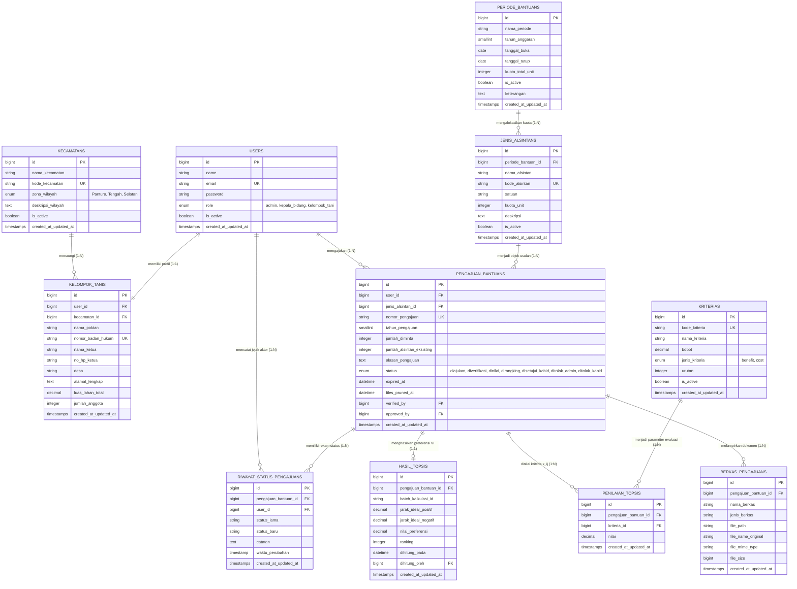

# Entity Relationship Diagram (ERD) dan Skema Basis Data Relasional
## Sistem Pendukung Keputusan Bantuan Alsintan Dinas Pertanian Kabupaten Subang
**Bahan Penyusunan Laporan Proyek Akhir: Bab III (Perancangan Basis Data)**

---

### 1. Deskripsi Perancangan Basis Data

Perancangan basis data pada Sistem Pendukung Keputusan (SPK) Penyaluran Bantuan Alat dan Mesin Pertanian (Alsintan) dirancang dengan memenuhi kaidah normalisasi bentuk ketiga (*Third Normal Form / 3NF*). Basis data ini mengintegrasikan sembilan tabel relasional utama serta dua tabel master penunjang wilayah kedinasan guna menjamin integritas referensial data (*referential integrity*), mencegah anomali pembaruan, serta memisahkan dokumen fisik dari database melalui penyimpanan privat terenkripsi.

---

### 2. Diagram Relasi Entitas (Mermaid ERD)

---

### 3. Matriks Relasi Antar-Tabel dan Integritas Referensial

| No | Tabel Asal (*Parent*) | Kardinalitas | Tabel Tujuan (*Child*) | Kunci Asing (*Foreign Key*) | Aturan Integritas (*On Delete*) |
|:--:|:---|:---:|:---|:---|:---|
| 1 | `kecamatans` | 1 : N | `kelompok_tanis` | `kelompok_tanis.kecamatan_id` | `SET NULL` (Data poktan tidak hilang jika master wilayah disesuaikan) |
| 2 | `users` | 1 : 1 | `kelompok_tanis` | `kelompok_tanis.user_id` | `CASCADE` (Menghapus akun akan membersihkan data profil poktan) |
| 3 | `users` | 1 : N | `pengajuan_bantuans` | `pengajuan_bantuans.user_id` | `RESTRICT` (Mencegah penghapusan akun jika memiliki riwayat usulan bantuan) |
| 4 | `periode_bantuans` | 1 : N | `jenis_alsintans` | `jenis_alsintans.periode_bantuan_id` | `SET NULL` (Alat tetap ada di sistem meski periode anggaran berganti) |
| 5 | `jenis_alsintans` | 1 : N | `pengajuan_bantuans` | `pengajuan_bantuans.jenis_alsintan_id`| `RESTRICT` (Kategori mesin tidak boleh dihapus jika sedang diajukan) |
| 6 | `pengajuan_bantuans` | 1 : N | `berkas_pengajuans` | `berkas_pengajuans.pengajuan_bantuan_id` | `CASCADE` (Penghapusan usulan otomatis membersihkan relasi berkas) |
| 7 | `pengajuan_bantuans` | 1 : N | `penilaian_topsis` | `penilaian_topsis.pengajuan_bantuan_id` | `CASCADE` (Nilai matriks terhapus jika usulan dihapus) |
| 8 | `kriterias` | 1 : N | `penilaian_topsis` | `penilaian_topsis.kriteria_id` | `RESTRICT` (Kriteria aktif tidak boleh dihapus saat proses penilaian berlangsung) |
| 9 | `pengajuan_bantuans` | 1 : 1 | `hasil_topsis` | `hasil_topsis.pengajuan_bantuan_id` | `CASCADE` (Rekap ranking terhapus jika usulan dihapus) |
| 10 | `pengajuan_bantuans` | 1 : N | `riwayat_status_pengajuans` | `riwayat_status_pengajuans.pengajuan_bantuan_id` | `CASCADE` (Audit log melekat pada entitas pengajuan) |
| 11 | `users` | 1 : N | `riwayat_status_pengajuans` | `riwayat_status_pengajuans.user_id` | `SET NULL` (Jejak audit tetap abadi meski akun operator dinonaktifkan) |

---

### 4. Kamus Data Rinci (Data Dictionary)

#### A. Tabel `users`
Menyimpan kredensial otentikasi akun pengguna dan tingkatan wewenang hak akses portal.

| Nama Kolom | Tipe Data & Panjang | Kunci | Nullable | Bawaan | Deskripsi & Aturan Bisnis |
|:---|:---|:---:|:---:|:---:|:---|
| `id` | BIGINT UNSIGNED | PK | Tidak | Auto | Identifikator unik akun pengguna. |
| `name` | VARCHAR(255) | - | Tidak | - | Nama lengkap pegawai dinas atau nama narahubung kelompok tani. |
| `email` | VARCHAR(255) | UK | Tidak | - | Alamat surel aktif yang digunakan sebagai identitas masuk portal. |
| `password` | VARCHAR(255) | - | Tidak | - | Kata sandi yang dienkripsi menggunakan algoritma Bcrypt (min. 8 karakter). |
| `role` | ENUM | - | Tidak | `kelompok_tani` | Peran pengguna: `'admin'`, `'kepala_bidang'`, `'kelompok_tani'`. |
| `is_active` | BOOLEAN | - | Tidak | `true` | Status keaktifan akun (`1` = Aktif, `0` = Dibekukan oleh Admin). |
| `remember_token` | VARCHAR(100) | - | Ya | NULL | Token penyimpanan sesi login tetap (*remember me*). |
| `created_at` | TIMESTAMP | - | Ya | NULL | Waktu akun didaftarkan ke sistem. |
| `updated_at` | TIMESTAMP | - | Ya | NULL | Waktu pembaruan informasi profil akun terakhir. |

---

#### B. Tabel `kelompok_tanis`
Menyimpan profil institusional kelompok tani, lokasi hamparan sawah, dan legalitas badan hukum.

| Nama Kolom | Tipe Data & Panjang | Kunci | Nullable | Bawaan | Deskripsi & Aturan Bisnis |
|:---|:---|:---:|:---:|:---:|:---|
| `id` | BIGINT UNSIGNED | PK | Tidak | Auto | Identifikator unik kelompok tani. |
| `user_id` | BIGINT UNSIGNED | FK | Tidak | - | Referensi relasi ke `users.id` (Relasi 1:1). |
| `kecamatan_id` | BIGINT UNSIGNED | FK | Ya | NULL | Referensi relasi ke wilayah `kecamatans.id`. |
| `nama_poktan` | VARCHAR(255) | - | Tidak | - | Nama resmi kelompok tani (contoh: Poktan Sri Mukti). |
| `nomor_badan_hukum` | VARCHAR(100) | UK | Tidak | - | Nomor pengesahan SK Kemenkumham atau SK Terdaftar Dinas Pertanian. |
| `nama_ketua` | VARCHAR(255) | - | Tidak | - | Nama lengkap ketua kelompok tani aktif. |
| `no_hp_ketua` | VARCHAR(50) | - | Tidak | - | Nomor kontak seluler aktif ketua (untuk koordinasi lapangan). |
| `desa` | VARCHAR(100) | - | Tidak | - | Nama desa/kelurahan domisili sekretariat dan hamparan poktan. |
| `kecamatan` | VARCHAR(100) | - | Tidak | - | Nama kecamatan (teks pencadangan kompatibilitas antarmuka). |
| `alamat_lengkap` | TEXT | - | Ya | NULL | Alamat sekretariat poktan atau titik kumpul kelompok. |
| `luas_lahan_total` | DECIMAL(8,2) | - | Tidak | `0.00` | Luas total hamparan sawah binaan dalam satuan Hektar (Ha). |
| `jumlah_anggota` | INT UNSIGNED | - | Tidak | `0` | Jumlah petani anggota aktif yang tergabung dalam poktan. |
| `created_at` | TIMESTAMP | - | Ya | NULL | Waktu pencatatan profil poktan pertama kali. |
| `updated_at` | TIMESTAMP | - | Ya | NULL | Waktu pembaruan data luas lahan atau anggota poktan. |

---

#### C. Tabel `jenis_alsintans`
Menyimpan data master kategori mesin pertanian dinas beserta alokasi kuota bantuan fisik tahunan.

| Nama Kolom | Tipe Data & Panjang | Kunci | Nullable | Bawaan | Deskripsi & Aturan Bisnis |
|:---|:---|:---:|:---:|:---:|:---|
| `id` | BIGINT UNSIGNED | PK | Tidak | Auto | Identifikator unik jenis alsintan. |
| `periode_bantuan_id`| BIGINT UNSIGNED | FK | Ya | NULL | Referensi relasi ke master `periode_bantuans.id`. |
| `nama_alsintan` | VARCHAR(255) | - | Tidak | - | Nama jenis mesin (contoh: Traktor Roda 2, Pompa Air 3 Inch). |
| `kode_alsintan` | VARCHAR(50) | UK | Tidak | - | Kode unik pengenal alat (contoh: `TR-2`, `TR-4`, `PMP`, `CBH`). |
| `deskripsi` | TEXT | - | Ya | NULL | Spesifikasi teknis, merek, daya tenaga kuda (HP), atau kapasitas kerja. |
| `satuan` | VARCHAR(50) | - | Tidak | `'Unit'` | Satuan penghitungan kuota barang (contoh: Unit, Paket). |
| `kuota_unit` | INT UNSIGNED | - | Tidak | `0` | Jumlah unit alokasi bantuan fisik yang disediakan dinas pada tahun berjalan. |
| `is_active` | BOOLEAN | - | Tidak | `true` | Status keaktifan alat untuk dipilih dalam formulir permohonan. |
| `created_at` | TIMESTAMP | - | Ya | NULL | Waktu pencatatan data alsintan ke sistem. |
| `updated_at` | TIMESTAMP | - | Ya | NULL | Waktu pembaruan informasi kuota unit alat. |

---

#### D. Tabel `kriterias`
Menyimpan parameter kriteria evaluasi metode TOPSIS, pembobotan desimal, dan sifat kriteria (*benefit* atau *cost*).

| Nama Kolom | Tipe Data & Panjang | Kunci | Nullable | Bawaan | Deskripsi & Aturan Bisnis |
|:---|:---|:---:|:---:|:---:|:---|
| `id` | BIGINT UNSIGNED | PK | Tidak | Auto | Identifikator unik kriteria evaluasi. |
| `kode_kriteria` | VARCHAR(20) | UK | Tidak | - | Kode baku kriteria: `C1`, `C2`, `C3`, `C4`, `C5`. |
| `nama_kriteria` | VARCHAR(255) | - | Tidak | - | Deskripsi parameter: Luas Lahan, Jumlah Anggota, Produktivitas, Kesiapan Operator, Alsintan Eksisting. |
| `bobot` | DECIMAL(5,4) | - | Tidak | - | Bobot kepentingan matematis kriteria ($w_j$), total seluruh bobot $= 1.0000$. |
| `jenis_kriteria`| ENUM | - | Tidak | `'benefit'`| Karakter kriteria: `'benefit'` (makin besar makin baik) atau `'cost'` (makin kecil makin baik). |
| `urutan` | INT | - | Tidak | `1` | Nomor urutan tampilan kolom pada antarmuka matriks evaluasi. |
| `is_active` | BOOLEAN | - | Tidak | `true` | Status keaktifan kriteria dalam perhitungan mesin TOPSIS. |
| `created_at` | TIMESTAMP | - | Ya | NULL | Waktu kriteria didaftarkan ke sistem. |
| `updated_at` | TIMESTAMP | - | Ya | NULL | Waktu penyesuaian bobot matematis kriteria. |

---

#### E. Tabel `pengajuan_bantuans`
Menyimpan transaksi permohonan bantuan dari kelompok tani, status tahapan usulan, dan kontrol retensi berkas.

| Nama Kolom | Tipe Data & Panjang | Kunci | Nullable | Bawaan | Deskripsi & Aturan Bisnis |
|:---|:---|:---:|:---:|:---:|:---|
| `id` | BIGINT UNSIGNED | PK | Tidak | Auto | Identifikator unik transaksi permohonan. |
| `user_id` | BIGINT UNSIGNED | FK | Tidak | - | Referensi relasi ke akun pemohon `users.id`. |
| `jenis_alsintan_id`| BIGINT UNSIGNED | FK | Tidak | - | Referensi relasi ke jenis alat `jenis_alsintans.id`. |
| `nomor_pengajuan`| VARCHAR(100) | UK | Tidak | - | Nomor agenda resmi permohonan (contoh: `REQ-2026-0001`). |
| `tahun_pengajuan`| SMALLINT UNSIGNED| - | Tidak | `2026` | Tahun anggaran pengajuan proposal bantuan. |
| `jumlah_diminta` | INT UNSIGNED | - | Tidak | `1` | Jumlah unit alat yang diajukan oleh pemohon. |
| `jumlah_alsintan_eksisting` | INT UNSIGNED | - | Tidak | `0` | Jumlah alsintan sejenis yang telah dimiliki poktan (indikator kriteria C5). |
| `alasan_pengajuan`| TEXT | - | Ya | NULL | Narasi urgensi kebutuhan mekanisasi sawah poktan. |
| `status` | ENUM | - | Tidak | `'diajukan'`| Status usulan: `'diajukan'`, `'diverifikasi'`, `'dinilai'`, `'dirangking'`, `'disetujui_kabid'`, `'ditolak_admin'`, `'ditolak_kabid'`. |
| `catatan_admin` | TEXT | - | Ya | NULL | Catatan evaluasi atau alasan penolakan berkas oleh verifikator dinas. |
| `catatan_kabid` | TEXT | - | Ya | NULL | Arahan atau catatan penetapan persetujuan/penolakan dari Kepala Bidang. |
| `expired_at` | DATETIME | - | Ya | NULL | Batas masa retensi berkas (+90 hari jika ditolak, +13 bulan jika disetujui). |
| `files_pruned_at`| DATETIME | - | Ya | NULL | Waktu penghapusan berkas fisik PDF oleh scheduler (NULL = berkas fisik masih ada). |
| `verified_by` | BIGINT UNSIGNED | FK | Ya | NULL | Referensi relasi ke admin pemeriksa `users.id`. |
| `approved_by` | BIGINT UNSIGNED | FK | Ya | NULL | Referensi relasi ke pejabat penyetujui `users.id`. |
| `verified_at` | DATETIME | - | Ya | NULL | Waktu verifikasi administratif diselesaikan. |
| `approved_at` | DATETIME | - | Ya | NULL | Waktu ketetapan persetujuan pimpinan diterbitkan. |
| `created_at` | TIMESTAMP | - | Ya | NULL | Waktu permohonan diajukan oleh kelompok tani. |
| `updated_at` | TIMESTAMP | - | Ya | NULL | Waktu pembaruan status atau data usulan. |

---

#### F. Tabel `berkas_pengajuans`
Menyimpan rekaman berkas fisik proposal PDF pemohon yang tersimpan pada partisi privat server.

| Nama Kolom | Tipe Data & Panjang | Kunci | Nullable | Bawaan | Deskripsi & Aturan Bisnis |
|:---|:---|:---:|:---:|:---:|:---|
| `id` | BIGINT UNSIGNED | PK | Tidak | Auto | Identifikator unik dokumen berkas. |
| `pengajuan_bantuan_id` | BIGINT UNSIGNED | FK | Tidak | - | Referensi relasi ke `pengajuan_bantuans.id`. |
| `nama_berkas` | VARCHAR(255) | - | Tidak | - | Judul deskriptif dokumen (contoh: Proposal Resmi Poktan). |
| `jenis_berkas` | VARCHAR(100) | - | Tidak | `'proposal'`| Kategori dokumen (contoh: proposal, sk_poktan, surat_desa). |
| `file_path` | VARCHAR(500) | - | Tidak | - | Lokasi fisik file di server privat (contoh: `pengajuan/1/hash.pdf`). |
| `file_name_original` | VARCHAR(255) | - | Tidak | - | Nama asli berkas saat diunggah oleh pengguna kelompok tani. |
| `file_mime_type` | VARCHAR(100) | - | Tidak | `'application/pdf'` | Tipe MIME dokumen (dibatasi hanya PDF sah untuk keamanan sistem). |
| `file_size` | BIGINT UNSIGNED | - | Tidak | - | Ukuran dokumen fisik dalam satuan byte (maksimal 5.242.880 byte / 5 MB). |
| `created_at` | TIMESTAMP | - | Ya | NULL | Waktu berkas selesai diunggah. |
| `updated_at` | TIMESTAMP | - | Ya | NULL | Waktu pembaruan berkas lampiran. |

---

#### G. Tabel `penilaian_topsis`
Menyimpan matriks keputusan asli ($x_{ij}$) yang merefleksikan nilai riil setiap alternatif usulan per kriteria evaluasi.

| Nama Kolom | Tipe Data & Panjang | Kunci | Nullable | Bawaan | Deskripsi & Aturan Bisnis |
|:---|:---|:---:|:---:|:---:|:---|
| `id` | BIGINT UNSIGNED | PK | Tidak | Auto | Identifikator unik entri penilaian kriteria. |
| `pengajuan_bantuan_id` | BIGINT UNSIGNED | FK | Tidak | - | Referensi relasi ke alternatif kandidat `pengajuan_bantuans.id`. |
| `kriteria_id` | BIGINT UNSIGNED | FK | Tidak | - | Referensi relasi ke parameter kriteria `kriterias.id`. |
| `nilai` | DECIMAL(12,4) | - | Tidak | `0.0000` | Nilai mentah alternatif $i$ pada kriteria $j$ ($x_{ij}$ pada Matriks Keputusan $X$). |
| `created_at` | TIMESTAMP | - | Ya | NULL | Waktu penilaian disimpan oleh verifikator dinas. |
| `updated_at` | TIMESTAMP | - | Ya | NULL | Waktu perbaikan nilai evaluasi kriteria. |

---

#### H. Tabel `hasil_topsis`
Menyimpan luaran akhir 6 tahapan matematis algoritma TOPSIS berupa jarak solusi ideal, skor preferensi, dan ranking.

| Nama Kolom | Tipe Data & Panjang | Kunci | Nullable | Bawaan | Deskripsi & Aturan Bisnis |
|:---|:---|:---:|:---:|:---:|:---|
| `id` | BIGINT UNSIGNED | PK | Tidak | Auto | Identifikator unik hasil kalkulasi usulan. |
| `pengajuan_bantuan_id` | BIGINT UNSIGNED | FK | Tidak | - | Referensi relasi unik ke `pengajuan_bantuans.id` (Relasi 1:1). |
| `batch_kalkulasi_id` | VARCHAR(100) | - | Tidak | - | Kode batch unik per kelompok perhitungan alsintan (UUIDv4). |
| `jarak_ideal_positif` | DECIMAL(15,8) | - | Tidak | `0.00000000` | Nilai jarak Euclidean alternatif ke Solusi Ideal Positif ($D_i^+$). |
| `jarak_ideal_negatif` | DECIMAL(15,8) | - | Tidak | `0.00000000` | Nilai jarak Euclidean alternatif ke Solusi Ideal Negatif ($D_i^-$). |
| `nilai_preferensi` | DECIMAL(15,10) | - | Tidak | `0.0000000000` | Nilai preferensi akhir $V_i = \frac{D_i^-}{D_i^+ + D_i^-}$ ($0 \le V_i \le 1$). |
| `ranking` | INT UNSIGNED | - | Tidak | - | Peringkat prioritas rekomendasi hasil pengurutan $V_i$ secara *descending*. |
| `dihitung_pada` | DATETIME | - | Tidak | - | Waktu eksekusi komputasi matematis berlangsung. |
| `dihitung_oleh` | BIGINT UNSIGNED | FK | Ya | NULL | Referensi relasi ke staf admin pengeksekusi `users.id`. |
| `created_at` | TIMESTAMP | - | Ya | NULL | Waktu pencatatan data ke tabel hasil. |
| `updated_at` | TIMESTAMP | - | Ya | NULL | Waktu pembaruan hasil kalkulasi ulang. |

---

#### I. Tabel `riwayat_status_pengajuans`
Menyimpan jejak audit (*audit trail*) kronologis perubahan status usulan guna memenuhi prinsip akuntabilitas kedinasan.

| Nama Kolom | Tipe Data & Panjang | Kunci | Nullable | Bawaan | Deskripsi & Aturan Bisnis |
|:---|:---|:---:|:---:|:---:|:---|
| `id` | BIGINT UNSIGNED | PK | Tidak | Auto | Identifikator unik log jejak status. |
| `pengajuan_bantuan_id` | BIGINT UNSIGNED | FK | Tidak | - | Referensi relasi ke usulan `pengajuan_bantuans.id`. |
| `user_id` | BIGINT UNSIGNED | FK | Ya | NULL | Referensi akun pelaku perubahan `users.id` (Admin/Kepbid/Poktan). |
| `status_lama` | VARCHAR(50) | - | Ya | NULL | Status permohonan sebelum terjadinya aksi perubahan. |
| `status_baru` | VARCHAR(50) | - | Tidak | - | Status permohonan terkini pasca-eksekusi aksi. |
| `catatan` | TEXT | - | Ya | NULL | Keterangan alasan perubahan status atau catatan resmi dinas. |
| `waktu_perubahan` | TIMESTAMP | - | Tidak | `CURRENT_TIMESTAMP` | Waktu presisi saat status usulan diperbarui di sistem. |
| `created_at` | TIMESTAMP | - | Ya | NULL | Waktu pembuatan entri catatan riwayat. |
| `updated_at` | TIMESTAMP | - | Ya | NULL | Waktu pembaruan entri catatan. |

---

#### J. Tabel `kecamatans`
Menyimpan master 30 wilayah kecamatan di Kabupaten Subang beserta pembagian zonasi potensi pertanian.

| Nama Kolom | Tipe Data & Panjang | Kunci | Nullable | Bawaan | Deskripsi & Aturan Bisnis |
|:---|:---|:---:|:---:|:---:|:---|
| `id` | BIGINT UNSIGNED | PK | Tidak | Auto | Identifikator unik kecamatan. |
| `nama_kecamatan` | VARCHAR(100) | - | Tidak | - | Nama kecamatan di Kabupaten Subang (contoh: Pagaden, Ciasem). |
| `kode_kecamatan` | VARCHAR(20) | UK | Tidak | - | Kode unik wilayah (contoh: `KEC-01`). |
| `zona_wilayah` | ENUM | - | Tidak | `'Tengah'` | Zonasi geografis: `'Pantura'` (padi & tambak), `'Tengah'` (lumbung padi), `'Selatan'` (hortikultura). |
| `deskripsi_wilayah`| TEXT | - | Ya | NULL | Karakteristik komoditas unggulan dan agroklimat wilayah. |
| `is_active` | BOOLEAN | - | Tidak | `true` | Status keaktifan wilayah operasional bantuan. |
| `created_at` | TIMESTAMP | - | Ya | NULL | Waktu pencatatan data kecamatan. |
| `updated_at` | TIMESTAMP | - | Ya | NULL | Waktu pembaruan data zonasi. |

---

#### K. Tabel `periode_bantuans`
Menyimpan master gelombang pengajuan bantuan berdasarkan tahun anggaran penetapan APBD/APBN.

| Nama Kolom | Tipe Data & Panjang | Kunci | Nullable | Bawaan | Deskripsi & Aturan Bisnis |
|:---|:---|:---:|:---:|:---:|:---|
| `id` | BIGINT UNSIGNED | PK | Tidak | Auto | Identifikator unik periode bantuan. |
| `nama_periode` | VARCHAR(255) | - | Tidak | - | Nama agenda gelombang (contoh: Penyaluran Alsintan APBD TA 2026). |
| `tahun_anggaran` | SMALLINT UNSIGNED| - | Tidak | `2026` | Tahun penetapan anggaran kedinasan. |
| `tanggal_buka` | DATE | - | Tidak | - | Tanggal awal dibukanya penerimaan usulan poktan. |
| `tanggal_tutup` | DATE | - | Tidak | - | Tanggal batas akhir pengajuan proposal oleh kelompok tani. |
| `kuota_total_unit`| INT UNSIGNED | - | Tidak | `0` | Total kumulatif seluruh unit mesin alsintan yang disediakan dinas. |
| `is_active` | BOOLEAN | - | Tidak | `true` | Status pembukaan gelombang bantuan secara sistem. |
| `keterangan` | TEXT | - | Ya | NULL | Keterangan dasar hukum penetapan anggaran dinas. |
| `created_at` | TIMESTAMP | - | Ya | NULL | Waktu pencatatan periode bantuan. |
| `updated_at` | TIMESTAMP | - | Ya | NULL | Waktu pembaruan informasi batas tanggal bantuan. |
