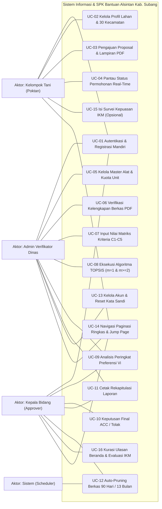
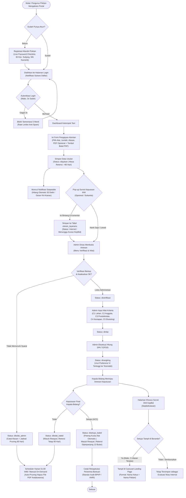
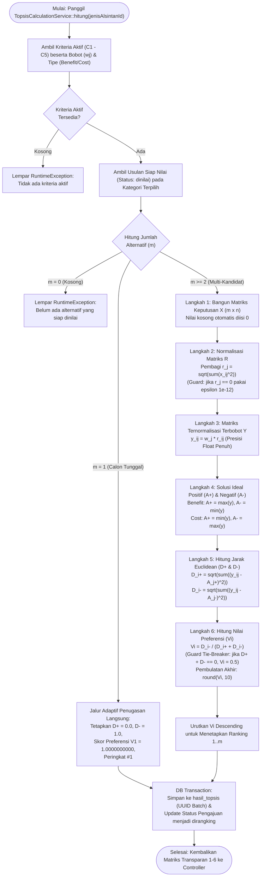
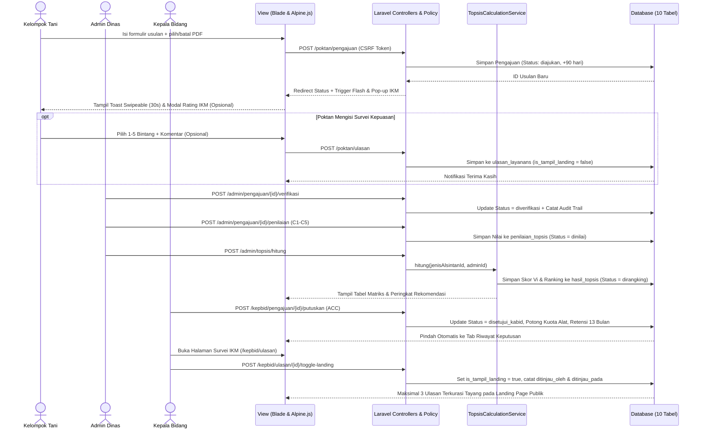
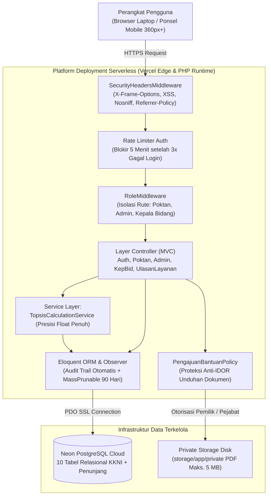
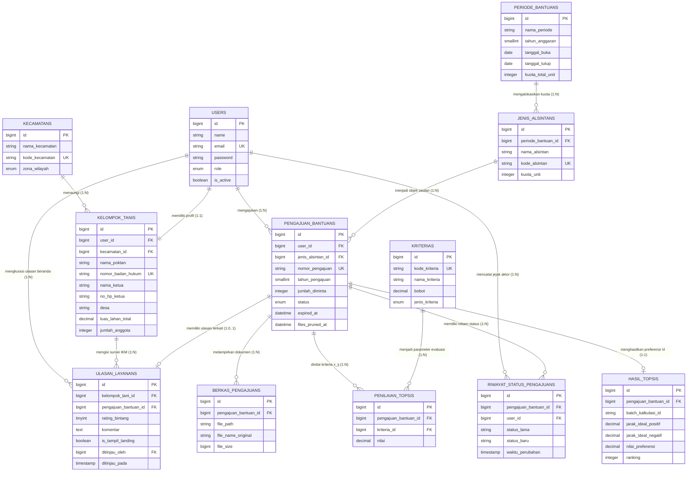

# Kumpulan Diagram Alur Sistem, Workflow, Arsitektur, dan ERD (Mermaid untuk Draw.io & Word)
## Sistem Pendukung Keputusan Bantuan Alsintan Dinas Pertanian Kabupaten Subang
**Bahan Penyusunan Laporan Proyek Akhir: Bab I, Bab III (Perancangan), dan Bab IV (Implementasi)**

---

## Panduan Impor Kode Mermaid ke Draw.io & Tempel ke Microsoft Word

Seluruh blok kode `mermaid` di bawah ini dirancang agar **kompatibel penuh dengan Draw.io (*diagrams.net*)** untuk dikonversi menjadi gambar vektor berkualitas tinggi sebelum ditempel ke naskah **Microsoft Word**:

1. Buka situs **[app.diagrams.net](https://app.diagrams.net/)** atau aplikasi desktop **Draw.io**.
2. Pada menu atas, klik **Arrange** > **Insert** > **Advanced** > **Mermaid...**
3. Salin (*copy*) seluruh isi kode di dalam salah satu blok `mermaid` di dokumen ini, lalu tempel (*paste*) ke kotak dialog Mermaid di Draw.io dan klik **Insert**.
4. Diagram akan langsung terbentuk sebagai objek vektor yang masih bisa Anda geser, beri warna *Harvesta Green* (`#14532D` / `#E1F12E`), atau rapikan tata letaknya.
5. Untuk memindahkan ke Microsoft Word:
   - Klik **File** > **Export as** > **PNG...** (pilih resolusi *Zoom 200%* atau *300%* agar tajam saat dicetak, centang *Transparent Background* jika perlu), lalu sisipkan gambar PNG tersebut ke Word (*Insert > Pictures*).

---

## 1. Diagram Use Case Sistem (3 Aktor & 16 Fungsionalitas)

Gunakan diagram ini pada **Bab III (Analisis Sistem / Use Case Diagram)**.

---

## 2. Alur Kerja Bisnis Sistem End-to-End (Activity / Workflow Diagram)

Gunakan diagram ini pada **Bab III (Perancangan Alur Proses Bisnis / Flowchart Sistem)**. Menggambarkan perjalanan utuh usulan bantuan dari pendaftaran poktan hingga evaluasi pimpinan dan pembersihan berkas.

---

## 3. Flowchart Mesin Algoritma TOPSIS (6 Langkah + Jalur Adaptif Calon Tunggal)

Gunakan diagram ini pada **Bab III / Bab IV (Rancangan Algoritma SPK TOPSIS)** untuk menjelaskan perhitungan matematis beserta penanganan kasus batas *Single Candidate* dan *Zero Division Guard*.

---

## 4. Sequence Diagram Interaksi Sistem (Pengajuan, Penetapan, & Survei IKM)

Gunakan diagram ini pada **Bab III (Perancangan Perilaku Sistem / Sequence Diagram)**.

---

## 5. Diagram Arsitektur Aplikasi & Keamanan Berlapis (System Architecture)

Gunakan diagram ini pada **Bab III / Bab IV (Arsitektur Deployment Serverless & Pengamanan Aplikasi)**.

---

## 6. Diagram Relasi Entitas / ERD (10 Tabel Utama + Penunjang) Siap Impor Draw.io

Gunakan kode berikut pada **Bab III (Perancangan Basis Data / ERD)**. Versi lengkap beserta kamus data rinci tersedia pada dokumen [03_ERD_dan_Skema_Database_PA.md](file:///d:/Alfath%20Kuliah/PA/Dokumen_PA/03_ERD_dan_Skema_Database_PA.md).

